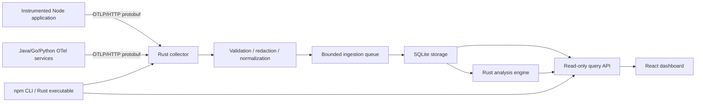

# Request X-Ray — System Architecture

**Status:** Proposed architecture, v0 design. **Audience:** maintainers, Rust/TypeScript contributors, AI coding agents, reviewers. **Rule:** This document is normative for implementation unless superseded by a reviewed ADR (Architecture Decision Record). The canonical domain types, OTLP decoder, loopback collector, SQLite repository and local query API are implemented. See the [collector guide](COLLECTOR.md) for the current receiver behavior.

## 1. Goals, non-goals, constraints

### Goals

- Interoperate with real OpenTelemetry trace exporters using OTLP/HTTP protobuf.
- Collect, store, index, analyze, and visualize trace data locally with a Rust backend.
- Provide Node.js instrumentation via the established OpenTelemetry JavaScript ecosystem.
- Offer a useful waterfall UI, trace search, and inspector without any cloud account.
- Support cross-language services if they emit valid OpenTelemetry spans.
- Preserve evidence, lineage, timing semantics, and uncertainty.
- Ship installable npm packages with platform-specific prebuilt Rust binaries.
- Enforce bounded resource usage and secure-by-default collection.

### Non-goals for v0.1

- Reimplement OpenTelemetry SDKs or change W3C trace propagation.
- Support all OTLP signals or protocols from day one: traces over HTTP/protobuf first; metrics/logs/gRPC later.
- Provide true root-cause proof, arbitrary code-level CPU profiling, automatic replay of side effects, distributed transactions, or production APM parity.
- Promise zero instrumentation, zero overhead, or cross-service visibility into uninstrumented components.
- Ship AI, remote collaboration, Kubernetes operators, billing, accounts, multi-tenancy, or large-scale cluster storage initially.

### Important invariants

1. Telemetry failures must not fail user requests.
2. Dropped spans, missing parent spans, clock problems, and sampling gaps must remain detectable.
3. Do not store secrets by default. Body capture disabled. No runtime remote network calls without explicit config (besides connecting to an explicitly configured local/remote collector).
4. Preserve trace and span identity; deduplicate by `(trace_id, span_id)` with an explicit conflict policy.
5. Never calculate critical path by simply summing overlapping spans.
6. No automatic production replay, load generation, or writes to traced services.
7. Version external contracts and maintain test fixtures.

## 2. Context and deployment



Local development is the default deployment. Collector and query API are separate HTTP listeners (defaults `127.0.0.1:4318` and `127.0.0.1:4731`). Never bind publicly by default. The dashboard is served from the query listener as static files. The collector uses `/v1/traces`; the query API uses `/api/v1/*`.

For remote use, require an explicitly selected deployment profile with TLS, authentication, origin controls, rate limits and a reviewed threat model. That profile is **out of scope for v0.1**.

## 3. Component boundaries

### Rust workspace

| Crate | Owns | Must not own |
|---|---|---|
| `xray-core` | Domain IDs, span/value objects, errors, time arithmetic, validation | HTTP, SQL, UI, file system |
| `xray-otlp` | OTLP protobuf decode/encode, resource/scope/span conversion, partial success mapping | Persistence, analysis heuristics |
| `xray-collector` | HTTP ingestion, compression, content validation, size limits, queue admission, health | SQL queries, UI rendering |
| `xray-storage` | SQLx SQLite schema, migrations, transactional insert, indexes, retention | Protocol decoding, frontend API |
| `xray-analysis` | Trace DAG, latency paths, patterns, grouping, comparisons, confidence/evidence | Network ingestion, AI-provider coupling |
| `xray-api` | Versioned read/query routes, pagination, validation, websocket/SSE only when justified | OTLP exports, business logic in handlers |
| `xray-cli` | Commands, config loading, subprocess/system launch, diagnostics | Duplicate business logic |

Additional optional crates (`xray-profiles`, `xray-auth`, `xray-otlp-grpc`) need ADRs and tests before inclusion.

### TypeScript packages

- `packages/node`: startup bootstrap, resource naming, opt-in instrumentation selection, custom span/event helpers, redaction configuration; use OTel JS SDK/exporters and instrumentations; do not silently create parallel SDKs.
- `packages/cli`: npm `bin` shim launches the correct prebuilt Rust executable; clear error on unsupported targets; release scripts ensure executable modes and integrity.
- `packages/dashboard`: React/Vite UI communicating *only* with the read API; never directly decode arbitrary collector payloads or access SQLite.
- `packages/types`: add only when sharing contracts becomes necessary; generated OpenAPI types are preferred over manually duplicated DTOs.
- `@request-xray/core` napi-rs: defer until profiling proves an in-process native operation is warranted; not a prerequisite for initial ingestion.

### Strict dependency direction

```text
xray-core <- xray-otlp
xray-core <- xray-storage
xray-core <- xray-analysis
xray-core <- xray-collector (uses otlp, storage ports)
xray-core <- xray-api (uses storage/analysis ports)
xray-cli -> composition/root
packages/node -> OpenTelemetry JS APIs
packages/dashboard -> generated public API client
```

Avoid cyclic crate dependencies. Depend on small repository/queue traits at boundaries when needed; avoid building an over-abstracted framework before requirements justify it.

## 4. Ingestion protocol and correctness

### OTLP/HTTP v0.1

- `POST /v1/traces` with `Content-Type: application/x-protobuf` and serialized `ExportTraceServiceRequest`.
- Accept standard OTLP protobuf. Validate media type and optionally gzip `Content-Encoding: gzip`; reject unsupported encoding with a precise status.
- Apply compressed and decompressed body limits to stop decompression bombs.
- Default OTLP port `4318`. gRPC `4317` **not** supported in v0.1.
- Honor `ExportTraceServiceResponse`, including `partial_success` and rejected span counts according to OTLP rules; never fake complete success if spans were rejected.
- Follow protocol semantics for transient vs permanent errors; send meaningful status codes, retry hints where appropriate, and no silent data loss when the queue is full.
- Follow canonical protobuf `.proto` definitions, pinned to a documented dependency version; support compliant exporters, not only our SDK.
- OTLP/HTTP JSON: explicit later compatibility option; don't claim JSON support until implemented and tested.

### Ingestion stages

1. Accept on the loopback listener. Validate routing and headers, then acquire an ingestion slot before reading the body.
2. Validate path/method/content type, enforce body limits and optional gzip processing.
3. Protobuf decode; distinguish malformed transport from individually invalid spans.
4. Canonicalize resource and instrumentation-scope metadata.
5. Validate span IDs, temporal ordering, attribute types, size, and allowable clock skew without changing valid timestamps.
6. Apply privacy controls **before persistence**; reject or remove forbidden attributes.
7. Pass the sanitized batch to the sink within the admitted request.
8. Batch transactional writes and record ingestion statistics.
9. Materialize/query trace summaries lazily or incrementally, benchmark-dependent.
10. Acknowledge accepted spans after the sink confirms commitment.

The ingestion acknowledgment boundary is SQLite transaction commit. The collector waits for SQLite commit before acknowledging accepted spans. [Acknowledgment ADR](adr/0008-acknowledge-ingestion-after-commit.md)

### Node instrumentation

- Bootstrap OTel JS SDK before importing application frameworks or instrumented libraries.
- Default to HTTP client/server tracing and relevant auto-instrumentation from pinned known-compatible OTel packages.
- Avoid duplicate SDK registration; identify and warn when another tracer provider exists, and support using a preconfigured provider/exporter path.
- Propagate W3C `traceparent`/`tracestate` and compatible baggage safely. Never capture baggage values indiscriminately.
- Set `service.name`, `service.version`, `deployment.environment.name` when known.
- Support manual span creation; business events require explicit developer calls.
- Make sampler, batch size, queue size, flush timeout, and exporter endpoint configurable.
- Include CJS and ESM smoke fixtures; ESM auto-instrumentation needs version-specific loader behavior.
- Browser instrumentation is a separate adapter; no promise that a server SDK can capture browser click-to-paint operations.

## 5. Domain model

### Canonical fields

```text
TraceId    16 raw bytes (32 lowercase hex in API)
SpanId      8 raw bytes (16 lowercase hex in API)
Span        trace_id, span_id, parent_span_id?, name, kind,
            service/resource identity, scope identity,
            start_ns, end_ns, status, attributes, events, links,
            dropped counts, flags, instrumentation/library info
Trace       derived trace_id, min_start_ns, max_end_ns,
            observed_span_count, service_count, has_error,
            completeness_flags, first_seen_at, last_seen_at
Evidence    rule_id, trace/span refs, measured values, confidence label,
            limitations, generated_at, rule_version
```

Keep event timestamps, link attributes, resource attributes, dropped counters, schema URLs, and status details. Do not flatten away OTLP semantics. Span kind is `INTERNAL`, `SERVER`, `CLIENT`, `PRODUCER`, `CONSUMER` or unspecified. IDs are opaque; do not manufacture parents for unparented spans.

### Step 1.2 domain model verification

`xray-core` accepts IDs as fixed-size arrays, byte slices or exact-length hexadecimal strings. It rejects incorrect lengths, nonhex digits and all-zero values. Hex input is case-insensitive and display emits lowercase with leading zeroes preserved. An absent parent is represented with `None`. Kind and status retain unrecognized numeric codes.

The model preserves resource and scope presence, separate schema URLs, entity references, trace state, flags, dropped counts and optional status details. Ordered attribute lists retain duplicate entries for later validation. Attributes preserve nested arrays and lists, bytes, signed integers, doubles and the distinction between an absent value and an explicitly empty value. See [trace decoding](OTLP_PROTOBUF.md#trace-decoding-and-conversion) for the wire mapping. Ingestion limits and redaction belong at the collector boundary before storage.

On 2026-11-19 with Rust 1.85.0, `cargo fmt --all --check`, `cargo clippy --offline --locked --workspace --all-targets --all-features -- -D warnings`, and `cargo test --offline --locked --workspace` passed. The domain tests cover binary and hexadecimal round trips, malformed ID rejection, and preservation of numeric codes.

### Late arrival and trace completeness

A trace is not "finished" merely because an HTTP response returned. Asynchronous consumers may appear later. Track `last_seen_at` and a configurable inactivity threshold for UI grouping, label trace completion as **observational/heuristic**, and permit late-arriving spans to update the trace. Missing parents may reflect sampling, collector loss, or uninstrumented services; show an explicit gap.

### Clock semantics

- `UnixNanos` accepts epoch nanoseconds from 0 through `i64::MAX` inclusive, which fit a signed SQLite integer. Negative values and unsigned values above that range return `TimestampOutOfRange`.
- `SpanInterval` enforces `end_ns >= start_ns` and allows zero-duration spans. Event timestamps use the same range and can fall outside the enclosing span interval. Cross-span ordering can reflect clock skew.
- `UnixNanos` serializes to a decimal JSON string. JavaScript can parse the string as `BigInt` for exact arithmetic.
- Show durations using each span's own timestamps; mark suspect cross-host ordering when skew is detected.
- Exclusive wall-clock time = span duration minus union of overlapping direct-child intervals **within the parent interval**, not simply sum of child durations.
- Critical path in a DAG needs async links, clock constraints, and unobserved work caveats. In v0.1 show parent-child waterfall; introduce "critical path" only after dedicated algorithm and reference fixtures.

Step 1.3 verification passed on Rust 1.85.0 and Node 20.20.2. Run `cargo test --offline --locked -p xray-core` and `node --test test/tests/timestamp-json.test.cjs`. The Node test invokes the Rust example and confirms that successive timestamps above JavaScript's safe integer range remain one nanosecond apart after parsing the JSON.

## 6. Storage architecture

### SQLite implementation

See the [storage guide](STORAGE.md) and the [SQLx migration](../crates/xray-storage/migrations/0001_traces.sql) for the implemented schema and retention behavior.

### Original schema sketch

```sql
CREATE TABLE resources (
  id INTEGER PRIMARY KEY,
  fingerprint TEXT NOT NULL UNIQUE,
  service_name TEXT NOT NULL,
  attributes_json TEXT NOT NULL
);
CREATE TABLE traces (
  trace_id BLOB PRIMARY KEY,
  started_ns INTEGER NOT NULL,
  ended_ns INTEGER NOT NULL,
  span_count INTEGER NOT NULL DEFAULT 0,
  last_ingested_at_ns INTEGER NOT NULL,
  has_error INTEGER NOT NULL DEFAULT 0
);
CREATE TABLE spans (
  trace_id BLOB NOT NULL,
  span_id BLOB NOT NULL,
  parent_span_id BLOB,
  resource_id INTEGER NOT NULL REFERENCES resources(id),
  name TEXT NOT NULL,
  kind INTEGER NOT NULL,
  started_ns INTEGER NOT NULL,
  ended_ns INTEGER NOT NULL,
  status_code INTEGER NOT NULL,
  status_message TEXT,
  attributes_json TEXT NOT NULL,
  scope_json TEXT NOT NULL,
  events_json TEXT NOT NULL,
  links_json TEXT NOT NULL,
  otlp_meta_json TEXT NOT NULL,
  PRIMARY KEY (trace_id, span_id)
);
CREATE INDEX idx_spans_trace_start ON spans(trace_id, started_ns);
CREATE INDEX idx_spans_resource_start ON spans(resource_id, started_ns);
CREATE INDEX idx_traces_started ON traces(started_ns DESC);
CREATE INDEX idx_traces_error_start ON traces(has_error, started_ns DESC);
```

This is an *illustrative migration*, not a final copied schema. Additional migration decisions: full-text/normalized route indexing, write conflict policy, foreign keys, trace summary consistency, filtered attribute indexes, WAL behavior, space reclamation, retention enforcement, and corruption recovery. Implement migrations in versioned SQL files; test fresh install and upgrade.

### Storage strategy

- SQLite WAL mode, busy timeout, bounded writer tasks, read connections/pool, transactions per batch.
- Separate indexable columns from bounded, sanitized JSON attribute blobs.
- Configuration defaults proposed: 500 MiB maximum DB and 7-day retention; tune after benchmarks. Specify deterministic eviction ordering (oldest completed/least-recently-seen traces) and prevent partial dangling records.
- Avoid full-text search over secret-like arbitrary attributes. Query API allowlists searchable keys.
- Trace ID / span ID duplicates: identical duplicates are idempotent; conflicting duplicates generate a conflict diagnostic and follow deterministic policy, not last-write-wins silently.
- Later: optional ClickHouse or external OTLP backend adapter **only if** workloads demand it.

## 7. Query API contract

All routes under `http://127.0.0.1:4731/api/v1`, loopback only in v0.1.

| Method/path | Purpose |
|---|---|
| `GET /health` | Liveness and readiness, no secrets |
| `GET /traces?limit=50&cursor=...&service=...&error=true` | Cursor-paginated trace summaries |
| `GET /traces/{traceId}` | Trace metadata and completeness flags |
| `GET /traces/{traceId}/spans` | Spans, events, links, normalized resource metadata |
| `GET /services` | Observed services and counts |
| `GET /stats` | Ingest/retention/drop counters and local health |
| `GET /config/capabilities` | Supported feature/capability list |

Future routes include `/analysis/{traceId}`, `/compare`, `/export`, `/rules`, `/service-graph`, and `/ai/explain` when implemented. No state-changing API beyond explicit administrative actions should exist in v0.1. Expose OpenAPI 3.1 description; generate TypeScript types from it and validate schema compatibility in CI.

The [query API guide](QUERY_API.md) and [OpenAPI schema](../schemas/collector.openapi.yaml) define the current response contract. Nanosecond values are decimal strings so JavaScript clients can preserve their precision.

### HTTP/API security

- Bind strictly to loopback in local mode; optional dashboard port randomization on conflict.
- Validate origin/Host where applicable to mitigate DNS rebinding; no permissive wildcard CORS.
- No privileged admin endpoints exposed unauthenticated to networks.
- Bound response pages, sort keys, filter grammars, query cost, and export size.
- Use content security policy, escaped attribute rendering, and no dynamic HTML evaluation.

## 8. Analysis engine contracts

### Layer A — Observed facts

Time spans, number of observed calls, recorded status codes, explicit exceptions, parent-child relationships, links, resource attributes, and version metadata.

### Layer B — Deterministic analysis

- Self-time intervals (accounting for overlapping children).
- Slowest observed spans and critical contributions without double-counting.
- Missing parent and inconsistent context diagnostics.
- Repeated normalized DB query shapes within one trace, with sanitization.
- Retry-shape heuristics from documented operations/metadata.
- Error propagation *candidate* chains, not proof of causality.

### Layer C — Comparative analysis

Compare matched endpoints/service/version/environment/time windows with sufficient sample sizes. Display n, percentiles, confidence intervals or guardrail flags, and potential sampling biases. Never compare mixed environments unlabelled or present one unusually slow trace as a statistically confirmed regression.

### Layer D — AI optional

Rules supply an evidence packet (IDs, redacted attributes, measurements, uncertainties), not raw unrestricted telemetry. AI may summarize and propose hypotheses; cannot promote speculation to verified facts. Provider/network access requires explicit opt-in. Local provider path is an optional adapter.

All analysis responses include `ruleId`, `ruleVersion`, `severity`, `classification: observed|pattern|hypothesis`, `evidence`, `limitations`, and `suggestedNextSteps`.

## 9. Dashboard architecture

Proposed screens:

1. **Overview:** latest traces, errors, services, collector health, ingestion gaps.
2. **Trace explorer:** filters, pagination, saved local views.
3. **Trace detail:** waterfall, tree, dependency relationships, zoom/pan, span events, links, attributes; errors and gaps clearly differentiated.
4. **Service topology:** observed graph; explicit "observed only" caveat.
5. **Investigations:** evidence-backed rules and comparisons (P1+).
6. **Configuration/Doctor:** SDK connection status, service names, dropped spans, redaction, retention.

Keep responsive keyboard navigation, accessible tables, contrast, no motion requirement, and virtualized spans for large traces. For huge trace sets, render portions/windowed timelines instead of one SVG element per span. UI state and API caching through TanStack Query; avoid stale analysis after late spans arrive. Show sample data distinctly labeled.

## 10. Distribution and platform matrix

### Target initial platform matrix

- macOS ARM64 and x64
- Linux x64 glibc and ARM64 glibc
- Windows x64 MSVC
- Linux musl, Windows ARM64, other platforms: future / community best-effort

The Rust collector is an **executable** launched by the npm CLI. Package it as architecture-qualified npm optionalDependencies with `os`/`cpu`/`libc` metadata, plus a platform-resolving JS shim. Add executable asset integrity tests and CI smoke installations per target. napi-rs optional packages concern a native Node addon and are not automatically identical to an executable distribution scheme.

Release order: publish platform artifacts for a version, verify registry availability/integrity, then publish root package. Multi-package npm publish is not atomic: release workflow needs retry/recovery logic. Prefer npm trusted publishing/OIDC where supported, provenance attestations, lockfile verification, SBOM and checksums. Verify package names before any release.

## 11. Operational observability

Expose local metrics/counters for accepted, rejected, redacted, duplicate, conflicting, queued, dropped, committed spans; request sizes; DB write failures; queue saturation; retention deletions; API latency; and SDK export failures where visible. Do not collect personal data in operational metrics. A `doctor` command checks listener reachability, exporter config, SDK startup, SDK version, permissions, SQLite health, host binding, and protocol capability.

## 12. Security model and privacy data flow

### Trust boundaries

1. Instrumented process → local collector: untrusted telemetry, potentially malicious oversized payloads.
2. Collector → local DB: sanitized validated records, no raw captured bodies by default.
3. DB → local query API → browser: derived and authorized local data, escaping and bounded queries.
4. Optional AI/provider/export: disabled by default; requires opt-in, preview, egress policy, auditability.

### Redaction policy

- Default drop: `authorization`, `cookie`, `set-cookie`, tokens, passwords, API keys, card numbers and obvious secret-shaped attributes/URLs.
- Default disable: raw request/response bodies, arbitrary HTTP headers, SQL bind parameter values, user identifiers, baggage values.
- Whitelist selectable safe metadata like route templates, method, status, sanitized DB operation, service name.
- Normalize URL paths/templates; strip query strings by default, avoid unique IDs where possible.
- User-defined deny/allow attribute controls; deny takes precedence; limit depth/count/length.
- Explain that reliable PII detection is impossible; application instrumentation must be configured carefully and remote tracing requires extra review.

### Threat cases and mitigations

- Decompression bombs: strict compressed/decompressed byte limits.
- Excessive spans/long attributes: enforce limits and drop/reject accounting.
- DNS rebinding/browser access: strict binding, Host/Origin rules, CSRF protection for stateful endpoints.
- SQL injection in filters: parameterized SQL and allowlisted sorts.
- XSS in attribute values: render as text, CSP.
- Symlink/path traversals: fixed workspace paths and validated storage directory permissions.
- Npm supply chain: pinned reproducible builds, checksums, provenance, advisories.
- Production outage from instrumentation: bounded exporter queue, timeouts, no blocking hot path, shutdown flush limit.

## 13. Testing and quality gates

| Level | Required checks |
|---|---|
| Domain | IDs, timestamps, nested spans, missing parents, late arrivals, duplicate/collision handling |
| OTLP conformance | Real exporter fixtures; protobuf, gzip, invalid payload, partial success, limits, status handling |
| DB | Fresh/upgrade migrations, concurrent read/write, retention, crash/restart, corruption diagnostics |
| Node SDK | CJS, ESM, Express/Fastify basic, propagation across two services, SDK shutdown |
| Analysis | Deterministic hand-verified fixtures, overlap, parallel spans, skew, sampling gaps, negative cases |
| API | JSON schema/OpenAPI, pagination, invalid input, bounds, precision, auth boundaries if later added |
| UI | Waterfall accuracy, accessibility, empty/gap/error states, 10k-span virtualization benchmark |
| E2E | One command demo, request emitted → Rust stored → dashboard shows exact span data |
| Releases | Installed tarball tests, platform binary smoke tests, executable permissions, npm provenance |

Use Linux/macOS/Windows CI, supported Node LTS versions, Rust stable with pinned minimum supported Rust version, and dependency audits. Benchmark before making performance claims. Security fixes must have regression tests.

## 14. Architectural decision records to open in Step 0

- ADR-0001: OTLP/HTTP protobuf first, default ports.
- ADR-0002: SQLite WAL + data model + retention.
- ADR-0003: Post-commit versus queued ACK policy.
- ADR-0004: Rust executable npm distribution versus napi-rs native addon.
- ADR-0005: Local-only security boundary and remote-mode non-goals.
- ADR-0006: Analysis classification/evidence schema.
- ADR-0007: Versioned semconv compatibility and generated OpenAPI schema.

## 15. Implementation rules for coding agents

1. Read **README → ARCHITECTURE → ROADMAP → DOCUMENTATION** before code changes.
2. Work on **one roadmap step/subtask at a time**. Maintain task checkboxes honestly; never mark unfinished work complete.
3. Before coding, define acceptance tests and boundaries. Implement simplest valid vertical slice; avoid premature abstraction.
4. Follow official OpenTelemetry specs; pin crate/library versions and record relevant spec status.
5. Keep Rust business logic out of HTTP handlers and TS/React out of collector internals.
6. No simulated traces masquerading as live data; demo fixtures always labeled.
7. Run the step-specific format/lint/test/build/e2e gates; record commands/results and any blockers.
8. Update docs, schemas, architecture/ADR notes when changing external contracts.
9. Do not publish to npm, push tags, access real production telemetry, or enable network AI without explicit owner approval.
10. Preserve security invariants and non-blocking instrumentation. Refuse shortcuts that bypass redaction or silent-drop accounting.

## 16. Reference specifications

- OTLP: https://opentelemetry.io/docs/specs/otlp/
- HTTP semconv: https://opentelemetry.io/docs/specs/semconv/http/
- Database semconv: https://opentelemetry.io/docs/specs/semconv/db/database-spans/
- Messaging semconv (development status): https://opentelemetry.io/docs/specs/semconv/messaging/
- OpenTelemetry JS: https://opentelemetry.io/docs/languages/js/
- ESM startup: https://github.com/open-telemetry/opentelemetry-js/blob/main/doc/esm-support.md
- napi-rs: https://napi.rs/docs/introduction/getting-started
